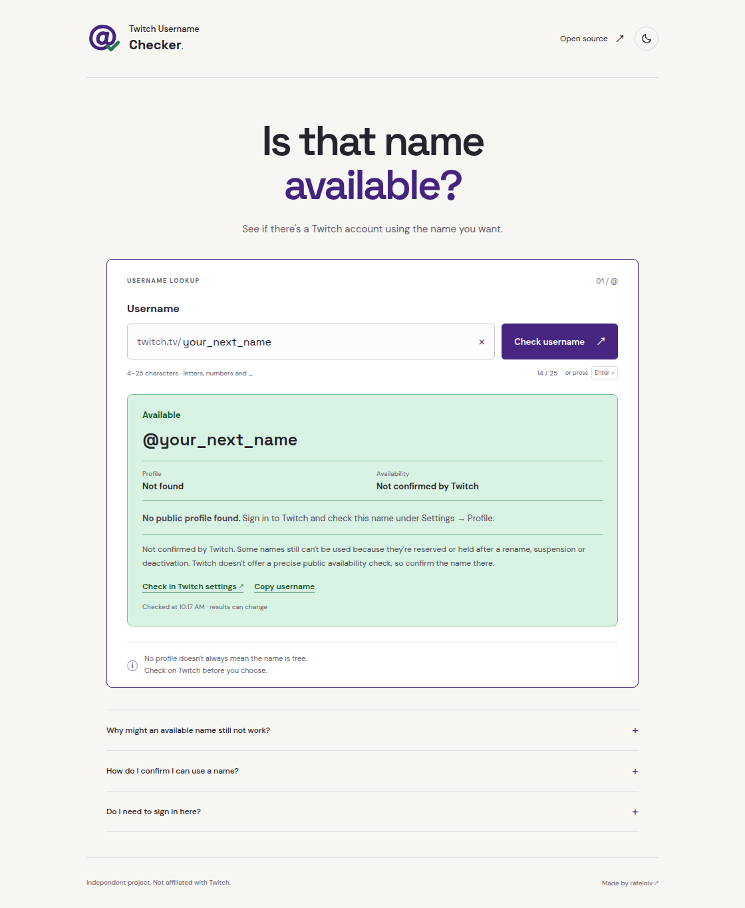

<p align="center">
  
</p>

<h1 align="center">Twitch Username Checker</h1>

<p align="center">Check a name before changing your Twitch username.</p>

<p align="center">
  <a href="https://rafelolv.github.io/TwitchUsernameChecker/"></a>
  <a href="https://www.twitch.tv/settings/profile"></a>
</p>

<p align="center">
  <a href="docs/PRIVACY.md">Privacy</a> ·
  <a href="CONTRIBUTING.md">Contribute</a> ·
  <a href="LICENSE">MIT license</a>
</p>

<details>
  <summary>See the site</summary>
  <br />
  <picture>
    <source media="(prefers-color-scheme: dark)" srcset="docs/images/preview-dark.png" />
    
  </picture>
</details>

## Using it

Enter a username and click **Check username**, or press Enter.
For several names, open **Check a list**, paste up to **100 names** (one per line,
comma or space separated), then click **Check list**. Results appear as each name
is checked. Duplicates are skipped. Use **Stop checking** to cancel; the queue also
stops if Twitch limits requests or a lookup fails. Names are checked one at a time, as soon as Twitch responds.

Use **All**, **Available**, **Unavailable** or **Failed** to filter the results.
Each page holds up to 20 names. **Copy available names** copies all names marked
Available, including those on other pages; unconfirmed names still need checking
on Twitch.

Use 4–25 letters, numbers or underscores. The site follows your browser’s light
or dark theme. Use the sun/moon button at the top to switch; it remembers your choice.

| Result          | What it means                                                      |
| --------------- | ------------------------------------------------------------------ |
| **Available**   | No public account was found, or Twitch confirmed the name is free. |
| **Unavailable** | An account uses the name, or Twitch says it can't be used.         |

> [!NOTE]
> **Available isn't a guarantee.** If you see **Not confirmed by Twitch**, the name
> could still be reserved after a rename, suspension or deactivation. Sign in to
> Twitch and try it in [Settings → Profile](https://www.twitch.tv/settings/profile)
> before choosing it. This tool doesn't reserve names or predict release dates.

No login is needed here, and searches aren't saved. The name you enter is sent
to Twitch when you run a check. [More about privacy](docs/PRIVACY.md).

## Something not working?

Tell us which browser you're using and what happened. Please leave out passwords,
tokens and account details.

<a href="https://github.com/rafelolv/TwitchUsernameChecker/issues"></a>

<details>
  <summary>Run locally</summary>

You'll need Node.js 24 and Python 3. There are no dependencies to install.

```sh
npm run dev
```

Open http://127.0.0.1:5173. To run the checks, use another terminal:

```sh
npm run check
```

See [Contributing](CONTRIBUTING.md), [Maintenance](docs/MAINTENANCE.md) and
[how the checks work](docs/AVAILABILITY.md) for development details.

</details>

---

<p align="center">
  Made by <a href="https://github.com/rafelolv">rafelolv</a> · <a href="LICENSE">MIT</a><br />
  Independent project, not affiliated with Twitch.
</p>
