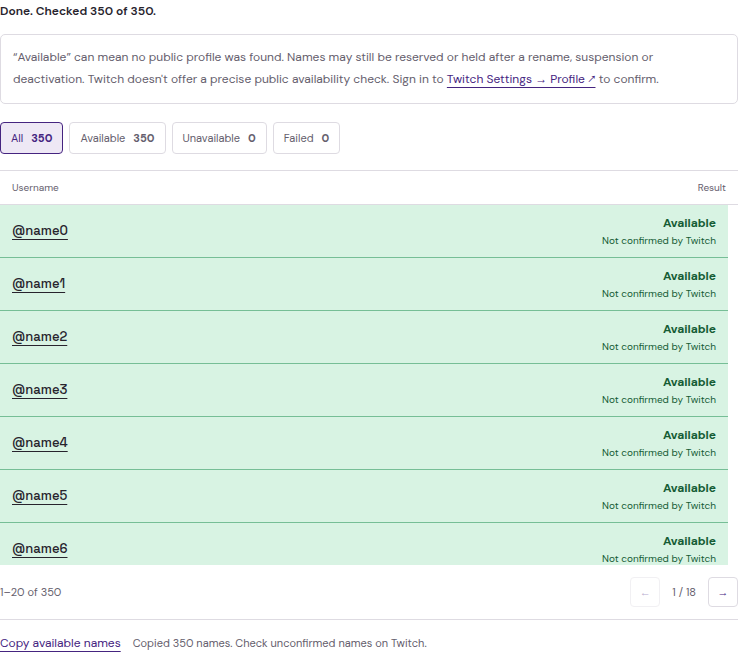

<p align="center">
  
</p>

<h1 align="center">Twitch Username Checker</h1>

<p align="center">Check a name before changing your Twitch username.</p>

<p align="center">
  <a href="https://rafelolv.github.io/TwitchUsernameChecker/"></a>
  <a href="https://www.twitch.tv/settings/profile"></a>
  <a href="https://github.com/rafelolv/TwitchUsernameChecker/releases/tag/v1.5.0"></a>
</p>

<p align="center">
  <a href="docs/PRIVACY.md">Privacy</a> ·
  <a href="CONTRIBUTING.md">Contribute</a> ·
  <a href="LICENSE">MIT license</a>
</p>

<details>
  <summary>See the site</summary>
  <br />
  <picture>
    <source media="(prefers-color-scheme: dark)" srcset="docs/images/preview-dark.png" />
    
  </picture>
</details>

<details>
  <summary>See list results</summary>
  <br />
  <picture>
    <source media="(prefers-color-scheme: dark)" srcset="docs/images/list-preview-dark.png" />
    
  </picture>
  <p>Example results. Names marked “Not confirmed by Twitch” still need checking on Twitch.</p>
</details>

## Keeping it simple

Free to use, with no account needed here. This tool is meant to do one job and stay
small, so frequent updates and new features aren't planned.

> [!IMPORTANT]
> **The only planned update is better username checks**, if Twitch introduces an
> official API that can confirm availability more accurately. Until then, this
> version is intended to stay as it is. There is no update schedule.

## Using it

Enter a username and click **Check username**, or press Enter.
Use 4–25 letters, numbers or underscores.

For a list:

1. Open **Check a list** and paste up to **350 names**, separated by lines, commas or spaces.
2. Click **Check list**. Names are checked one at a time; duplicates are skipped.
3. Filter by **All**, **Available**, **Unavailable** or **Failed**, with 20 names per page.
4. Use **Copy available names** to copy those names from every page. Unconfirmed names still need checking on Twitch.

**Stop checking** pauses the list. **Continue remaining** picks up pending and
failed names without repeating completed checks. A failure or Twitch rate limit
stops the queue again; wait a while before continuing after a rate limit.

Editing or clearing the list starts over. Pending work isn't saved when you close
or reload the page.

The site follows your browser's light or dark theme. The sun/moon button lets you
switch and remembers your choice.

| Result          | What it means                                                      |
| --------------- | ------------------------------------------------------------------ |
| **Available**   | No public account was found, or Twitch confirmed the name is free. |
| **Unavailable** | An account uses the name, or Twitch says it can't be used.         |

> [!NOTE]
> **Available isn't a guarantee.** If you see **Not confirmed by Twitch**, the name
> could still be reserved after a rename, suspension or deactivation. Sign in to
> Twitch and try it in [Settings → Profile](https://www.twitch.tv/settings/profile)
> before choosing it. This tool doesn't reserve names or predict release dates.

No login is needed here, and searches aren't saved. The name you enter is sent
to Twitch when you run a check. [More about privacy](docs/PRIVACY.md).

## Something not working?

Tell us which browser you're using and what happened. Please leave out passwords,
tokens and account details.

<a href="https://github.com/rafelolv/TwitchUsernameChecker/issues"></a>

<details>
  <summary>Run locally</summary>

You'll need Node.js 24 and Python 3. There are no dependencies to install.

```sh
npm run dev
```

Open http://127.0.0.1:5173. To run the checks, use another terminal:

```sh
npm run check
```

See [Contributing](CONTRIBUTING.md), [Maintenance](docs/MAINTENANCE.md) and
[how the checks work](docs/AVAILABILITY.md) for development details.

</details>

---

<p align="center">
  Made by <a href="https://github.com/rafelolv">rafelolv</a> · <a href="LICENSE">MIT</a><br />
  Independent project, not affiliated with Twitch.
</p>
